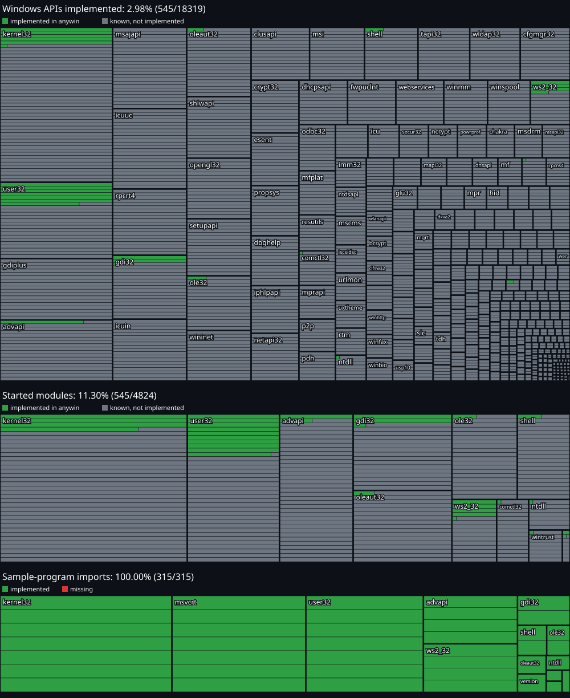

# anywin

A static Windows → Linux relinker. It takes an x86-64 PE executable and produces a standalone
native Linux ELF that calls Linux implementations of the imported Win32 functions.
No Wine, no PE loader at runtime, no compatibility layer at runtime.

> **Status: Stage 1 works.** The first target, `todo.exe` (a MinGW-built Win32 GUI app), relinks
> and runs fully on a real Cinnamon desktop (window, tray icon, menus, persistence). The runtime
> grows one capability at a time, driven by example executables.

## Coverage

[](docs/COVERAGE.md)
[](docs/COVERAGE.md)
[](docs/COVERAGE.md)
[](docs/COVERAGE.md)

[](docs/COVERAGE.md)

<!-- coverage-text:start -->
**Windows APIs implemented: 545 / 18,319 (2.98%).** Started modules: 545 / 4,824 (11.30%). Sample-program imports: 315 / 315 (100.00%). Runtime exports: 649.
<!-- coverage-text:end -->

<sub>One square per item, in the style of the AnyPS5 progress map. The denominator is Microsoft's
Win32 metadata (`Microsoft.Windows.SDK.Win32Metadata`, 18,319 P/Invoke entry points across 368
DLLs), not our own export table: green is implemented in anywin, grey is known but not implemented.
The second map section zooms in on modules where work has started; the third shows the union of
imports across the sample programs. COM vtable methods, undocumented exports and C runtime names
are outside the Win32 denominator. Generated by `tools/coverage/gen.py`; details and the full
per-module table are in [`docs/COVERAGE.md`](docs/COVERAGE.md).</sub>

## Usage

```sh
make                                   # builds build/anywin and build/libanywin.o
build/anywin todo.exe -o build/todo    # relink
./build/todo                           # runs on your normal X11 display
build/anywin --list todo.exe           # show which imports are implemented
```

`xvfb-run` is only used by the tests (a throwaway virtual display so they never touch your
desktop); the relinked program is an ordinary X11 client.

## How it works

1. `anywin` reads the PE, resolves its imports against the runtime's export table and
   relinks the image into an ELF together with `libanywin.o`.
2. The runtime (`runtime/`) implements the Win32 subset in C. The Windows calling convention
   (`ms_abi`) is used at the boundary.
3. Graphics go through a hand-written X11 wire-protocol client and a small TrueType
   rasterizer, so the output has no X11 or font library dependencies.

## What is implemented (Stage 1)

| Area | Files | Notes |
|---|---|---|
| kernel32 | `kernel32.c`, `sync.c`, `util.c` | command line/env defaults, module handles, `GetProcAddress`, real `VirtualProtect`/`VirtualQuery`, critical sections, mutexes, TLS |
| msvcrt / UCRT | `msvcrt.c`, `printf.c` | startup, stdio (48-byte `FILE` layout), heap, strings, time, `atexit`, signals, one printf engine with Win64 argument slots; both msvcrt and UCRT startup names |
| X11 + fonts | `x11.c`, `font.c` | wire-protocol client (windows, images, input, clipboard, XEmbed tray), TrueType rasterizer (cmap 4/12, glyf, AA, glyph cache) |
| GDI | `surface.c`, `region.c`, `gdi*.c`, `drawtext.c` | DCs, brushes, pens, fonts, regions, text, basic primitives |
| user32 | `user32_*.c` | window classes, `CreateWindowExA`, message queue, timers, painting/update regions, input, focus/capture, non-client borders and scrollbars, icons/cursors |
| Menus / dialogs | `menu.c`, `menu_popup.c`, `msgbox.c` | popup menus, `TrackPopupMenu`, `MessageBox` |
| Controls | `controls/*.c` | Button, Static, Edit, ComboBox, SysListView32, SysHeader32 |
| advapi32 | `advapi32.c` | file-backed registry under `~/.anywin/registry/`; Run-key values also write `~/.config/autostart/*.desktop` |
| ws2_32 | `ws2_32.c` | Winsock 2 over Linux sockets: startup, TCP/UDP, `select`, sockopts, name resolution, address conversion |
| shell32 | `shell32.c` | `Shell_NotifyIcon` over the X11 system tray |
| SEH | `seh.c` | `__C_specific_handler`, unwind lookup, unhandled-exception filter, crash report with RIP/RVA |

`runtime/SCOPED_SRCS` lists the files that are built; deferred files stay on disk but are not
compiled.

## Results on `todo.exe`

Also checked by hand on a real X11/Cinnamon desktop: everything works, including the system tray.
Note that `todo.exe` itself hides to the tray when its window is closed with the X button (as on
Windows); use the tray menu's Exit to quit.

Automated checks, run under Xvfb with `ANYWIN_STRICT=1`: clean relink (108 imports, 0 unimplemented), full
form and ListView render, add / select / edit / complete / delete / search / column sort, data
survives a restart, empty-title MessageBox, no unimplemented calls.

Not done or not tested yet:

* Second-instance detection (the named mutex and `FindWindow` are per-process).
* Tray clicks end to end (Xvfb has no tray manager).
* ListView type-ahead, rubber-band selection, column drag reorder; multiline Edit; undo.
* DIB sections, `BitBlt` from bitmaps, palettes, paths, C++ exceptions, COM.
* Advanced Winsock (overlapped I/O, `WSAAsyncSelect`, `WSAPoll`, raw sockets).

## Benchmark: anywin vs Wine 11.11 (Staging)

Reproduce with `python3 -I tests/bench.py [runs]` (needs `Xvfb`, `xdotool`, `wine`). It uses a private
Xvfb display, a throw-away `HOME` and a fresh `WINEPREFIX`. Numbers below are medians of 7 runs on
one machine (12 cores, Linux 6.18, Xvfb, no window manager), 2026-11-26, on commit `75294b7`.
`todo.exe` is the GUI program; `bench_cpu.exe` (`tests/bench_cpu.c`, MinGW `-O2`) is the same
binary for both. Two earlier 7-run series gave the same CPU results within 1% (totals 1023 and
1027 ms vs Wine's 1352 and 1348 ms; `snprintf` 173 ms both times vs 338 ms).

**todo.exe (GUI)**

| | anywin | Wine 11.11 |
|---|---|---|
| Time to window visible | **15 ms** | 548 ms |
| Memory, RSS (all processes) | **7.7 MB** | 452 MB |
| Memory, PSS (shared counted once) | **7.7 MB** | 202 MB |
| Processes | **1** | 9 |
| Idle CPU (5 s) | **0.0 %** | 1.2 % |
| On-disk size of the program | 3.4 MB, single static ELF | needs `todo.exe` + Wine install (491 MB in `/usr/lib/wine`) + 375 MB prefix |
| One-time setup | relink 95 ms | prefix init ~10 s |

**Console hello world, process start to exit**

| anywin | Wine, cold (no wineserver) | Wine, warm (wineserver running) |
|---|---|---|
| **1.2 ms** | 415 ms | 7.6 ms |

**CPU / CRT micro-benchmark** (`bench_cpu.exe`, lower is better)

| Test | anywin | Wine |
|---|---|---|
| 400M-iteration integer loop | 391 ms | 387 ms |
| 6M malloc/free | **57 ms** | 225 ms |
| sort 4M integers | 315 ms | 319 ms |
| 1.5M `snprintf` (ints, string, float) | **167 ms** | 338 ms |
| memcpy 2 GB (1 MB blocks) | 86 ms | 81 ms |
| Total | **1022 ms** | 1351 ms |

Reading the results:

* Startup and memory are where anywin wins by a wide margin: no wineserver, no prefix, no
  loaded Windows DLLs, one small process.
* Plain compute is the same (it is native x86-64 code either way). `malloc` is faster because it
  uses glibc's allocator directly.
* `snprintf` is now about 2x faster than Wine. Profiling showed the float conversions consumed
  about 80% of the time: each `%f` did two glibc `snprintf` passes (sizing and formatting) plus a
  `malloc`/`free`. `runtime/printf.c` now formats `%f` exactly with 128-bit integer arithmetic for
  precisions 0-9 and falls back to glibc for the rest (`%e`/`%g`, more digits, huge values), and
  bounded results are rendered into a stack buffer instead of the heap.
* `memcpy` is at parity. Glibc's ifunc variant is slow for 0.5-2 MiB copies on this machine, so
  `runtime/msvcrt.c` uses a short AVX2 loop in that range (falling back to glibc elsewhere and on
  CPUs without AVX2); 2 GB of 1 MiB copies went from ~110 ms to ~85 ms, Wine is 81 ms.
* Caveats: one machine; the GUI startup time is polled with `xdotool` every few milliseconds, so
  treat it as accurate to roughly 10-20 ms; Wine runs include starting a fresh wineserver each
  time; only one small GUI program and one synthetic CRT test were measured, so this says nothing
  about large applications or Wine's much wider API coverage.

## Design rules

* Implement general Win32 mechanisms, never application-specific behavior (no checks on
  program name, window class/title, file name or control id). `tests/no_overfit.sh` greps for this.
* Scope grows by example executables; each new capability gets a regression test.

## Environment variables

| Variable | Purpose |
|---|---|
| `ANYWIN_DEBUG` | trace runtime activity |
| `ANYWIN_STRICT` | abort on calls to unimplemented functions |
| `ANYWIN_LDFLAGS` | extra linker flags used by `anywin` |
| `ANYWIN_DRIVE_C` | host directory mapped to `C:\` |
| `ANYWIN_FONT_DIR` | extra font directory |
| `CC` | C compiler used for build and relink |

## Requirements

Linux x86-64, gcc, GNU ld. For tests: `xvfb-run`, `xdotool`, ImageMagick `import`, `python3`,
and `x86_64-w64-mingw32-gcc` to build probe programs.

## Tests

```sh
make test      # tests/run.sh: hooks, imports, hello_console, hello_gui, todo smoke, todo P0
make coverage  # regenerate the API coverage map from the built sample programs
```

Package tests (run individually): `core_env`, `core_stdio`, `core_gui`, `core_gui_controls`,
`core_menu`, `core_scroll`, `core_registry`, `core_winapi`, `core_seh`, `core_tray`, `gdi_render`,
`region_unit`, `listview_unit`, `x11_font`, `winsock`. `tests/bench.py` is the Wine comparison, not part of `make test`. Tests that open windows always use `xvfb-run`.

## Known issues

* An open ComboBox drop-list only closes on the next in-app click (clicks outside every app
  window are not delivered); mouse coordinates are relative to the wrong window while another
  top-level holds capture.
* The XEmbed tray icon is left for the tray manager to map. Mapping it ourselves while it was
  still a root window made Cinnamon's window manager (Muffin) crash when the app exited.
* If `~/.config` does not exist, the app-data folder cannot be created (a fresh `HOME` in tests
  needs `.config` created first).
